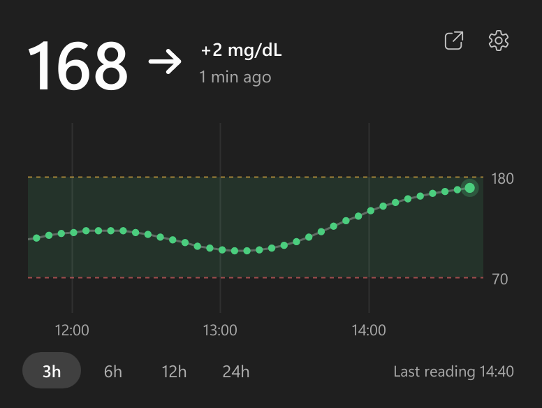

# Nightscout Glance

Glucose at a glance, right in your Windows taskbar (and, experimentally, your macOS menu bar).

Nightscout Glance sits in the system tray and shows the current glucose value from your [Nightscout](https://nightscout.github.io/) site as a number. Hover over it for a history graph.



## Features

- **The value is the icon.** The tray shows the number itself, redrawn for light and dark taskbars so it is always readable. Red below your low threshold, amber above your high threshold, dimmed when readings are stale.
- **Hover for history.** A flyout shows the value, trend arrow, change since the last reading and a graph of the last 3, 6, 12 or 24 hours with your target range.
- **Notifications** when glucose leaves the target range or readings stop arriving.
- **mg/dL and mmol/L.**
- **Lightweight.** A single 9 MB executable, about 4 MB of private memory, no installer, no runtime to install, no background services. It wakes up once per expected reading.
- **Private.** It talks only to your Nightscout site. No accounts, no telemetry. Your API secret is stored encrypted with Windows DPAPI.

## Install

1. Download `NightscoutGlance.exe` from the [latest release](https://github.com/burnedikt/nightscout-glance/releases/latest) and put it wherever you like.
2. Run it. The settings window opens on first start: enter your Nightscout address and, if your site is not public, an API secret or access token (a token with the `readable` role is enough).
3. Windows hides new tray icons in the overflow menu (the `^` arrow). Drag the number out onto the taskbar so it stays visible.

Right-click the tray number for the menu (open Nightscout, refresh, settings, quit). Double-click opens your Nightscout site.

Settings live in `%APPDATA%\Nightscout Glance\settings.json`.

### macOS (experimental)

The macOS version shows the value and trend arrow as text in the menu bar, with the same hover flyout and settings window. Right-click the value for the menu. It has had a first round of testing on an Apple Silicon Mac, but it is still new, so expect rough edges and please report them.

1. Download `NightscoutGlance-macos.zip` (from a release if one includes it, otherwise from the latest [CI run](https://github.com/burnedikt/nightscout-glance/actions/workflows/ci.yml) artifacts) and unzip it.
2. Move `Nightscout Glance.app` to Applications.
3. The app is not notarized, so macOS blocks it on first launch. Clear the download flag once:

   ```
   xattr -dr com.apple.quarantine "/Applications/Nightscout Glance.app"
   ```

The API secret is stored in the login Keychain. Because the app is not signed with a developer certificate, macOS asks once after every update whether the new version may read it; choose **Always Allow**. Settings live in `~/Library/Application Support/Nightscout Glance/settings.json`.

"Start at login" remembers where the app is, so move it to Applications before turning it on.

## Build from source

Requires [Rust](https://rustup.rs/) (on Windows with the MSVC toolchain).

```
cargo build --release
```

The binary is `target/release/nightscout-glance.exe`. On macOS, `bash scripts/bundle-macos.sh` builds a universal `Nightscout Glance.app` into `dist/`.

Useful flags while developing:

- `--demo` runs with generated data instead of a real Nightscout site.
- `--screenshots <dir>` renders the flyout and settings window to PNG files and exits.

### Layout

| Path | What |
| --- | --- |
| `src/nightscout.rs` | Nightscout REST client (portable) |
| `src/settings.rs` | Settings file |
| `src/render.rs` | Graph and trend arrow drawing, glucose zones (portable) |
| `src/platform/windows/` | Windows tray icon (the number is drawn into the icon), flyout hosting, DPAPI, autostart |
| `src/platform/macos.rs` | macOS menu-bar item, flyout hosting, Keychain, LaunchAgent autostart |
| `src/main.rs` | App state, flyout and settings window logic |
| `ui/app.slint` | UI (Slint) |
| `site/` | Landing page |
| `assets/brand/` | Icon and brand image set |

## Not a medical device

Nightscout Glance is a convenience display. Do not use it to make treatment decisions; always confirm with your CGM receiver or a blood glucose meter. It is not affiliated with or endorsed by the Nightscout project.

## License

MIT, see [LICENSE](LICENSE). The UI is built with [Slint](https://slint.dev), used under the Slint Royalty-free Desktop, Mobile, and Web Applications License.
